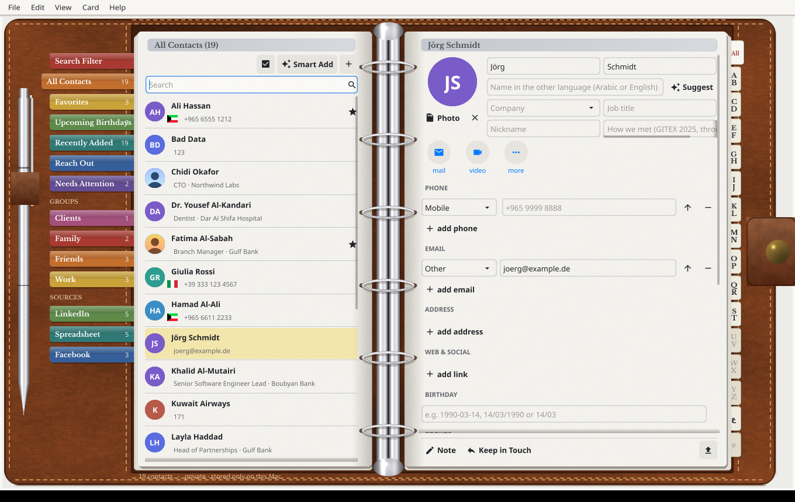
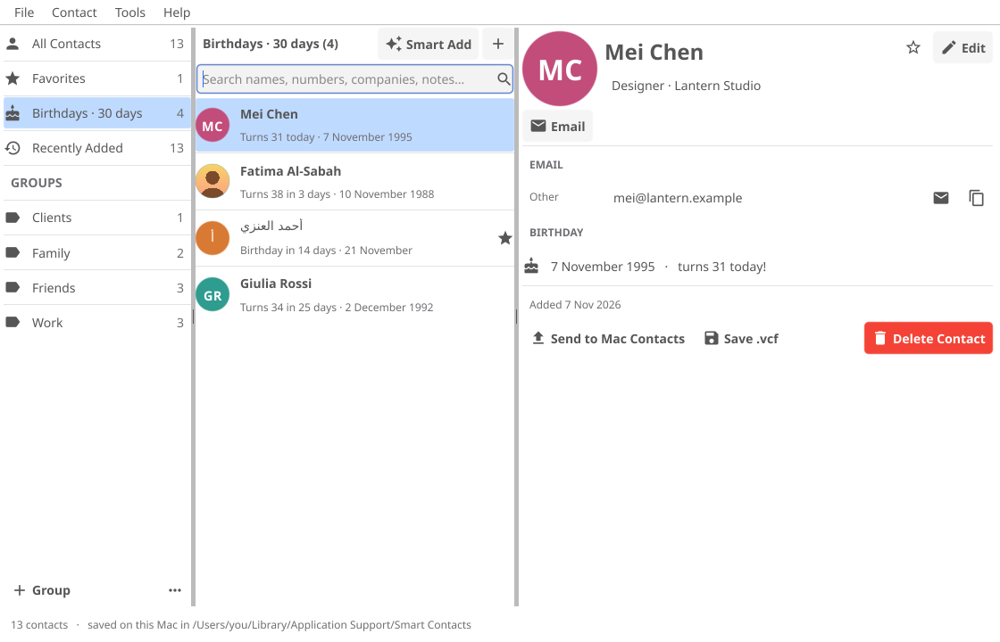

# Smart Contacts

A fast, native Mac address book written in Go ([Fyne](https://fyne.io)), built to be **the one place
all your contacts come together**: your Mac and iPhone, other phones, Gmail, Outlook, LinkedIn,
spreadsheets and notes are imported, matched and merged into a single, clean card per person.
Everything stays on your Mac, in one readable file, with backups and a 30-day trash. Names work in
Arabic and English, and numbers are tidied into one international format.

<p align="center"></p>



## Install

Paste this into Terminal on your Mac (Apple Silicon):

```bash
curl -fsSL https://raw.githubusercontent.com/jamalxcode/smart_contacts/main/install.sh | bash
```

It downloads the latest build, puts **Smart Contacts.app** in Applications and opens it. Run the same
line again to update. (Downloading with `curl` avoids the "unidentified developer" warning a browser
download would trigger, because the app is ad-hoc signed rather than notarised.)

Every push to `main` is compiled, tested and packaged by GitHub on a real Mac
([build workflow](.github/workflows/build.yml)) and published as the
[latest release](https://github.com/jamalxcode/smart_contacts/releases/tag/latest).

### Updating

Once installed, choose **Help → Check for Updates…**. If there's a newer build it shows what
changed, then downloads it, closes the app, swaps in the new version and reopens it. Your contacts
are untouched. The app never checks by itself; running the install line again also updates.

## What it does

**Bring Everything In (File menu, and the first screen).** A checklist walks through every source
below, then Clean Up and Look for Duplicates, ticking off each one as it's done. File → Import (⌘O)
takes contacts from:

| Source | What to export |
|---|---|
| Mac & iPhone | nothing — read straight from the Mac's Contacts app (iPhone via iCloud) |
| Another phone | Android: Contacts → Export → .vcf · old iPhone: icloud.com → Export vCard |
| Gmail / Google | contacts.google.com → Export (Google CSV or vCard) |
| Outlook / Hotmail | outlook.com → People → Manage → Export contacts (CSV) |
| LinkedIn | Settings & Privacy → Data privacy → Get a copy of your data → Connections |
| Yahoo, iCloud, others | the account's export, as vCard or CSV |
| Spreadsheets | any .csv or .xlsx — columns matched automatically (English or Arabic headers), adjustable |
| Notes / text | a .txt or pasted text with several people (one per line, or blocks) |
| Telegram | Telegram Desktop → Export Telegram data → Contacts list (JSON) — includes numbers |
| Facebook / Snapchat friends | their data downloads (JSON) — names only, so matched to people you have |
| A phone over Bluetooth / AirDrop | *Receive from a Phone* waits for the .vcf the phone sends |
| Business cards | Smart Add → Business Card Image, or drag a photo/screenshot onto the window |

Or drag files onto the window. Every import shows a preview first:

- **Matching:** people you already have are matched by phone, email, LinkedIn profile or name
  (across Arabic and English, and across spellings like Mohammed / Muhammad / محمد).
- **Enriching:** a matched card gets what's new (numbers, emails, job title, company, LinkedIn
  link, the name in the other language) instead of a duplicate being created.
- **You decide on name-only matches:** a card matched only by name is listed separately with the
  likely answer pre-selected ("very likely", "likely" or "unsure") — check and change any of them.
- **Re-importing is exact:** a card from Mac Contacts or Telegram is recognised by its own ID next
  time, so refreshing never creates doubles.
- **Where each detail came from:** every phone, email, link and address shows its source and date
  ("LinkedIn · Mar 2026"); the sidebar lists your sources.
- **Timeline, kept apart from your notes:** "Connected on LinkedIn", "Became Facebook friends",
  "Added from Google", "Job changed: was … now …", meetings from business cards. When a source
  disagrees (another company or birthday) the card keeps its value and the timeline records the
  other. Your own notes stay yours.
- **Names-only lists** (Facebook, Snapchat) only enrich people you have; unmatched names are added
  only if you tick them.
- **Clean up automatically** applies the safe fixes during import and shows you only doubtful ones;
  duplicates among the people just imported are offered for review.
- **Safety:** a backup is saved before every import.

**Clean Up (Card menu).** Phones and emails are checked against what's known:

- **Phones:** 00 → +, +965 added to Kuwaiti numbers, stray zeros removed (+44 (0)20…,
  +966 05…, an extra 0 on a Kuwaiti number), and Arabic digits converted. A number with no
  obvious country (0501234567) takes its country from clues on the same card: address, other
  numbers, email domain. If nothing fits, you pick.
- **Emails:** typos fixed (gmial.com, .con), mailto: and stray spaces removed, and values in the
  wrong field moved (an email typed as a phone, or the other way round).
- **Duplicates:** the same number or email twice on one card is removed.
- **Links and names:** "@khalid" under Telegram becomes its profile link; a first and last name
  entered the wrong way round ("Al-Kandari" / "Dr. Yousef") are swapped back.
- **Wrong numbers:** 00000000, 12345678, too short or too long, or impossible Kuwaiti prefixes are
  flagged for removal. Clear junk is pre-ticked; numbers that might be real are not.
- **Safety:** 171, 112 and 7-digit 180… service lines are left alone, and a backup is saved
  before applying.

**Notes clean-up and duplicates.** Clean Up also tidies notes: repeated lines, runs of blank
lines, HTML and `\n` left by exports, and lines that only repeat a number or email on the card.
Card → Look for Duplicates (⇧⌘D) does both kinds of de-duplication: the same person on several cards
(merged into the fullest card) and repeats inside a card (numbers, emails, links, addresses, note
lines).

**Reach them any way they use.** Each card shows buttons for what it actually holds: Call,
Message, WhatsApp, Email, FaceTime, plus LinkedIn, Telegram, Instagram (DM), Messenger, X,
Signal, Snapchat, TikTok, GitHub or Skype when there's a profile link or handle. *More* offers
number-based options (Telegram or Signal by number, FaceTime Audio, Teams chat).

**Calendar log.** View → Calendar Log (⇧⌘L) reads the Mac Calendar app (including Google, Outlook
and iCloud calendars added to the Mac) or an .ics file. Each card then lists the meetings the
person attended (by email or full name) or was mentioned in (full name, Arabic or English, in the
title, place or notes), upcoming ones first, and shows "last met".

**Photos and business cards.** Click the round picture on a card to set or remove the person's
photo (iPhone HEIC works). A business card photo or screenshot is read on the Mac (Apple's own
text recognition, Arabic and English), turned into a contact — or used to update the matching
one — and the image is kept on the card under *Business Cards*.

**Names in two languages.** Each card can hold the name in Arabic and English side by side
(محمد المطيري / Mohammed Al-Mutairi); *Suggest* fills the other spelling for common names. Search
finds people in either language.

**When you last talked.** Card → Update Last Talked reads Messages, call history and Mail on this
Mac (macOS asks you to give the app Full Disk Access) and shows on every card when you were last
in touch and how: "Last talked 3 days ago · WhatsApp". WhatsApp chat exports dropped on the window
count too, as do meetings in the calendar. *People Not in Contacts* lists numbers and emails you
write to or call often that aren't in your book, to add or dismiss. It all stays on this Mac.

**Keep in touch.** Set "keep in touch every month" (or week, quarter, year) on anyone; *Reach Out*
lists who's due, longest first, and a daily notification reminds you, along with birthdays. *Note*
adds a dated entry to the card's timeline, and "How we met" is a field of its own.

**Quick Find from the menu bar.** The menu bar icon opens a small search window (⇧⌘O in the app):
type a name, press Return, the number is copied. Favorites sit in the same menu with call and
message.

**Search filters and smart groups.** `company:boubyan`, `title:engineer`, `group:family`,
`source:linkedin`, `city:salmiya`, `country:kuwait`, `code:965`, `has:email`, `no:phone`,
`talked:<30d`, `talked:>1y`, `is:favorite`, `is:due`; a minus reverses one (`-group:work`).
Any search can be saved as a smart group in the sidebar.

**Needs Attention.** Cards with something to tidy are listed in the sidebar, and the card shows a
*Review* button.

**Tidy jumbled notes with AI.** Finds notes that are run together, full of export codes or
repeated, and rewrites them readably while keeping every name, number, date and email. It runs only
with Cloud AI on (the note text goes to your OpenRouter model), asks before sending, and shows each
note before and after; a rewrite that seems to have dropped a number, email or date isn't ticked.

**Merge your way.** Merging shows where the cards disagree — name, job, birthday, photo — and you
pick; every number, email and note is kept.

**Edit right on the card.** There's no Edit button: every field on the card can be changed where it
is. Save and Revert appear once something changes, and moving to another person (or quitting)
with unsaved changes asks "Are you sure you want to update…?" — Save, Don't Save or Cancel.

**Undo everything (⌘Z / ⌘⇧Z).** Every change — an edit, an import, a clean-up, a merge, a
delete — can be undone and redone. Edit → History lists this session's changes ("Undo back to
here") and the saved restore points (before each import, clean-up and de-duplication, and daily).

**Many at once.** ⌘-click to add people one by one, Shift-click for a range, or ⌘A for everyone shown
(the tick button above the list does the same). Right-click the selection — or More… in the bar
under the list — to Clean Up those cards, Tidy their notes with AI, Look for Duplicates among them,
Merge, add or remove a group, Favorite, Keep in Touch, copy them as text, export, or delete.
Deleting several cards asks twice ("Delete 5 cards?" then "Are you sure?"), and Return never
confirms a delete — the red button has to be clicked.

**Backups you control.** File → Back Up To… writes everything (contacts, photos, business cards,
calendar log, history) to a drive or folder you pick, encrypted with AES-256 if you give a
password. File → Restore from Backup… brings one back (and can itself be undone). The OpenRouter
key is never in a backup. Undo history now survives quitting the app.

**A Filofax on screen.** The app opens as a closed cognac-leather organiser — stitched cover,
gilt title, strap and brass snap. Click it (or press any key) and it opens at the page you left:
a chrome pen in its loop, coloured index tabs for your lists and groups coming out of the left
page, white pages with grey title bars on a stack of page edges, the chrome six-ring binder, and
cream A–Z tabs (AB, CD … ع, #) down the right edge. To close it, click the strap on the right (a hint
appears when you point at it, and it asks first) or press ⇧⌘W.
Settings choose whether it opens at the last page or the first, and whether to show the closed
cover at all. View → Filofax Look switches back to plain Mac panes. Everything is drawn by the
app; the printed parts are set in Libre Baskerville, names and fields in a font with Arabic.

**Search Filter tab.** The first index tab opens a small form on the page — Name, Company, Country
(by address or phone code), City and "Anything else" (a number, an email, a word from the notes).
Only people matching every filled-in field stay on the page, as you type; the filter can be saved
as a smart group.

**Country flags.** Every phone number shows its country's flag — 🇰🇼 for +965, 🇬🇧 for +44 —
in the list, on the card (updating as you type) and in Quick Find. The flags are small pictures
because the toolkit can't draw colour emoji.

**A Mac app, by Apple's rules.** Light and dark mode with the system colours, a tinted sidebar,
13-point text, Contacts-style cards (round message / call / video / mail buttons, grey labels
beside each value, Share at the bottom), the standard File, Edit, View, Card and Help
menus with Contacts' shortcuts, right-click menus on people, buttons named for what they do
("Delete", not "Yes"), and Esc / Return in every dialog.

**Everything else**

- **Three panes** — groups and sources on the left, a searchable list, the contact card on the right.
- **Search that forgives** — any script, with or without accents or hamza (أحمد = احمد), Persian
  letters, part of a phone number with or without spaces (`9999 8888`, `٩٩٩٩`), company, notes.
- **Smart Add** (⌥⌘N) — paste one person's signature or business card; read on this Mac
  (optional Cloud AI). It warns if they're already in your contacts.
- **Quick actions** — Call, Message, WhatsApp, Email, Maps (the Mac's own apps); last contacted.
- **Birthdays** — `1990-03-14`, `14/03/1990` or `14/03`; next 30 days with the age they turn.
- **Groups** — tick on the Edit page; renaming or deleting a group never deletes people.
- **Connections (six degrees)** — link people (⌘K); *How Are They Connected?* (⌘⇧K) finds the
  shortest chain between two people, up to six steps; colleagues at one company are linked.
- **Export** — vCard or CSV (both names and sources included), or copy to Apple Contacts.
- **Safe by default** — atomic saves, daily backups, backups before imports and clean-ups, Trash.



## Where your data lives

`~/Library/Application Support/Smart Contacts/`

| File | What |
|---|---|
| `contacts.json` | every contact (plain, readable JSON) |
| `photos/` | one small JPEG per contact photo |
| `backups/` | `contacts-YYYY-MM-DD.json`, last 30 days |
| `config.json` | settings, including the optional OpenRouter key (permission 600, not the Keychain) |

### Privacy: everything stays on this Mac

- The data folder is readable only by your Mac user (folders 700, files 600), is excluded from
  Spotlight, and is not in iCloud Drive. FileVault encrypts it on disk.
- The app makes **no network connections and has no accounts or sync**. Smart Add reads text
  locally. Cloud AI (OpenRouter) is **off by default** and only works if you tick
  *Allow Smart Add to send pasted text to OpenRouter* in Settings and add a key.
- Call, Message, WhatsApp and Maps open the Mac's own apps (FaceTime, Messages, WhatsApp, Maps).
- Copying contacts to Apple's Contacts app, or saving an export into iCloud Drive / Dropbox /
  Google Drive, asks first, because those sync off the Mac. Temporary .vcf files are deleted.
- **This repository holds only the code** — no contacts are ever committed here.

## Settings

- **Country code** (default `965`, Kuwait) — used to understand local numbers like `9999 8888`.
- **Sort by** first or last name.
- **Cloud AI** (off by default), with the **OpenRouter key and model** for Smart Add (default
  `anthropic/claude-haiku-4.5`; *Test AI* checks it).

## Keyboard

The shortcuts follow Apple's Contacts app where there's an equivalent.

| Keys | Action |
|---|---|
| ⌘N | new card |
| ⇧⌘N | new group |
| ⌥⌘N | Smart Add |
| ⌘O | import |
| ⇧⌘R | import from Mac Contacts |
| ⌘F | find |
| ⌘L / Return | start typing in the card |
| ⌘S | save |
| ⌘⌫ | delete card (to Trash) |
| ⌘Z / ⇧⌘Z | undo / redo |
| ⌘C | copy (the whole card as text when nothing is being typed) |
| ⌘A / ⇧⌘A | select all cards shown / deselect all |
| ⌘-click / Shift-click | add one to the selection / select a range |
| ⇧⌘S | select cards |
| ⇧⌘M | merge selected cards |
| ⌘1 – ⌘4 | All Contacts, Favorites, Upcoming Birthdays, Recently Added |
| ⇧⌘F | mark as favorite |
| ⌘K / ⇧⌘K | connect to… / how are they connected? |
| ⇧⌘D | look for duplicates |
| ⇧⌘L | calendar log |
| ⌘, | settings |
| ⌘5 / ⌘6 | Reach Out / Needs Attention |
| ⌘J | add a note |
| ⇧⌘U | update last talked |
| ⇧⌘O | Quick Find |
| Esc / Return | cancel / confirm a dialog |

## Roadmap

Planned: organisation / "how I know them" / "met at" fields linked into connections, a menu-bar
quick search, birthday notifications, and encrypted backups.

Not planned, by design: online lookup or enrichment of contacts (searching Google, X or LinkedIn
for people, reverse lookup by phone or email), cloud sync, or accounts.

Known limits: the app is ad-hoc signed, so install it with the curl line (a browser-downloaded
zip is held by macOS).

## Building it yourself

Needs Go and the Xcode command-line tools (`xcode-select --install`):

```bash
git clone https://github.com/jamalxcode/smart_contacts.git
cd smart_contacts
./build.command      # tests, packages, installs to /Applications and opens it
```

Code map: `model.go` (contacts, search, phones, birthdays) · `store.go` (file, backups, trash,
photos) · `vcard.go` · `tools.go` (CSV, duplicates, clean-up) · `smart.go` (Smart Add) ·
`importers.go` (vCard/CSV/Excel/notes readers, import planning) · `phone.go` (numbers by country, emails) · `cleanup.go` · `names.go` (Arabic ↔ English names) · `graph.go` (connections, six-degrees paths) · `social.go` (profiles, ways to reach) ·
`socialimport.go` (Telegram, Facebook, Snapchat) · `calendar.go` · `cards.go` (business cards, text recognition) · `mac.go` (Mac Contacts) · `ui.go`, `editor.go`, `dialogs.go` (the window) · `model_test.go`.

See [LIMITATIONS.md](LIMITATIONS.md) for what the app deliberately won't do and what's next, and
[LESSONS.md](LESSONS.md) for notes from building it.
